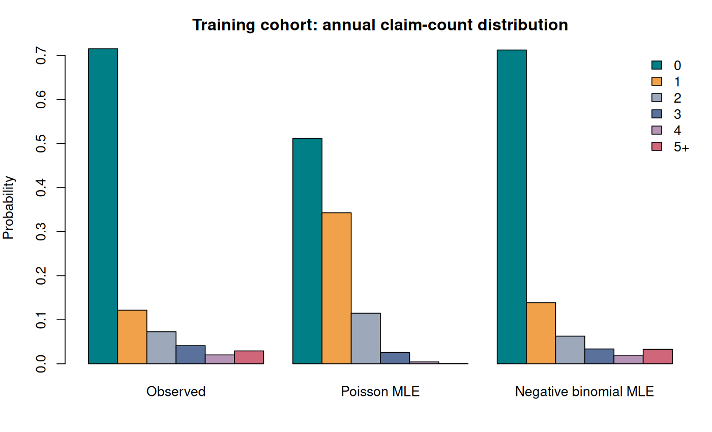
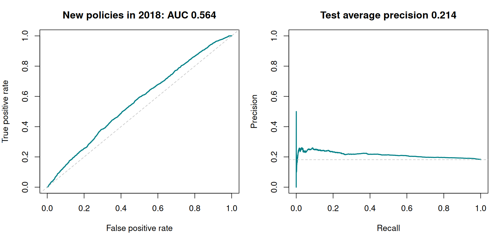

# Motor insurance risk modeling in R

**How do claim-count distributions, claim probability and positive annual costs combine into an expected-cost model?** A reproducible actuarial analysis of a public Spanish motor-insurance portfolio, with a forward evaluation on previously unseen policies.

Jihad Boussata · R · maximum likelihood · logistic/Gamma GLMs · two-part cost models



## What this project does

1. Fits Poisson and negative-binomial count models with consistent MLE parameters.
2. Compares exponential, lognormal, Gamma, Weibull and Lomax distributions for **positive annual aggregate claim cost**.
3. Fits logistic GLMs for at least one claim and Gamma-log GLMs for positive annual cost.
4. Combines probability × conditional positive mean into expected annual cost; compares with a training-mean baseline.

This corrects an important terminology issue: `Cost_claims_year` is an annual aggregate per policy-period, not individual-claim severity.

## Honest held-out findings

| Untouched 2018 test | Model | Training-based baseline |
| --- | --- | --- |
| Claim ROC AUC | 0.564 | 0.500 |
| Claim average precision | 0.214 | 0.182 |
| Claim Brier score ↓ | 0.162 | 0.159 |
| Positive annual cost: Gamma deviance ↓ | 1.817 | 1.859 |
| Expected annual cost: RMSE (EUR) ↓ | 674.86 | 669.10 |

The logistic ranking improvement is small. Its probability error is slightly worse than the constant training-prior baseline, and the combined annual-cost model **does not beat the training-mean RMSE baseline**. These results are retained because the change in cohorts is material: claim prevalence moves from 28.5% in training to 18.2% in test. This is a modeling and evaluation case study, with clear limits on predictive usefulness.



## Reproduce

Use R 4.3.3 or a compatible later R installation. No CRAN packages are needed. Obtain the public source CSV as described in [data/README.md](data/README.md), then run from the repository root:

```bash
Rscript tests/run_tests.R
Rscript scripts/run_analysis.R --data data/raw/Motor_vehicle_insurance_data.csv
```

The input uses semicolons as separators, decimal points and day/month/year dates. The script checks outcomes and duplicate policy/renewal records. It writes aggregate tables, plots, source checksums and `sessionInfo.txt` to `results/`. Use `--output another-directory` for a separate run.

## Forward, policy-disjoint cohorts

| Cohort | Rows | Unique policies | Claim rate |
| --- | --- | --- | --- |
| train | 35,987 | 32,654 | 28.5% |
| validation | 9,505 | 9,505 | 34.6% |
| test | 11,343 | 11,343 | 18.2% |

Training uses renewals through 2016. Validation uses 2017 policies absent from training; test uses 2018 policies absent from both earlier cohorts. Later rows from previously seen policies are excluded from evaluation. This tests new-policy generalization and is stricter than a random row split. IDs identify policyholder–product combinations; different products belonging to one person cannot be linked with the available identifier.

## Methodological decisions

- Compute age and driving experience at each renewal, replacing the hardcoded 2024 reference date.
- Exclude cumulative claims/history ratios, lapse fields and unverified snapshot variables. The paper dates vehicle market value to 31 December 2019, so it is excluded from prospective predictors.
- Learn missing-value medians on training rows. Keep test untouched during model/threshold selection.
- Report both the standard 0.5 threshold and a validation-selected F1 threshold. High recall at the latter comes with low precision; there is no claimed business-optimal decision threshold.
- Use descriptive fit diagnostics; do not present naive KS p-values for fitted distributions or unqualified coefficient inference from repeated policy rows.

`R/` contains reusable data, distribution and metric functions; `scripts/` runs the analysis; `tests/` checks metric definitions, repeated-policy separation and predictor availability. See [methodology](docs/METHODOLOGY.md), [source-to-project changes](docs/CHANGES.md) and the numeric outputs in [results/](results/).

## Data and attribution

Source: Lledó and Pavía, [Dataset of an actual motor vehicle insurance portfolio, version 2](https://doi.org/10.17632/5cxyb5fp4f.2), CC BY 4.0. Companion paper: Segura-Gisbert, Lledó and Pavía, [European Actuarial Journal (2025), 15, 241–253](https://doi.org/10.1007/s13385-024-00398-0). The source contains 105,555 policy-period records from November 2015–December 2018. My implementation expands four R practical assignments into one documented project. New code is MIT licensed; dataset rights remain CC BY 4.0. Raw policy records are not redistributed here.
